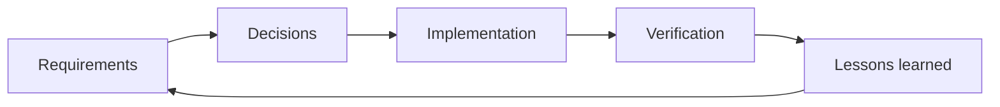

# Henry Marcelo Cabrera Robles

**Software developer and founder based in Quito, Ecuador.**

I build business workflows and tools for rigorous AI-assisted development. My main focus is **ModuleFlow**; **rigorkit** is the toolkit I use across my projects.

## What I’m building

| Project | What it does | Explore |
| --- | --- | --- |
| **ModuleFlow** | Workflow and task tracking where every step has an owner and every handoff leaves proof. The goal: your company keeps running even when you’re not there. | [Visit ModuleFlow](https://moduleflow.tech) |
| **rigorkit** | A tool-neutral collection of skills and workflows that keeps requirements, decisions, implementation and verification connected in AI-assisted development. | [Explore the repository](https://github.com/harrypotter48/rigorkit) |

## From building to learning

I keep a personal knowledge vault of lessons from building software. I’m sharing practical, reusable takeaways about:

- Working with coding agents while keeping requirements and verification connected.
- Writing useful specs and preserving decisions between sessions.
- Designing workflows with clear ownership and accountable handoffs.
- Learning from approaches that did not work.

My current AI toolkit: **ChatGPT, Claude, Codex, OpenCode and DeepSeek**.

## Let’s exchange experiences

How do you keep AI-assisted development consistent as your projects grow?

Find me on [AI Lounge](https://ai.lounge.ai/@harrypotter48), explore [rigorkit](https://github.com/harrypotter48/rigorkit), or visit [ModuleFlow](https://moduleflow.tech).
